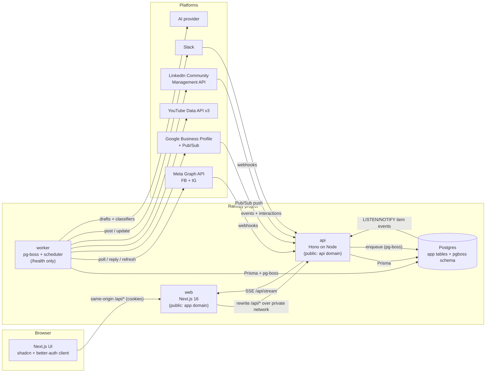

# Unified Social Inbox: Plan

> Status: **Phase 3 done; Phase 4 built, acceptance pending (needs GBP access)** · Last updated: 2026-11-13
> Source of truth for decisions. Progress is tracked in [`PROGRESS.md`](./PROGRESS.md).

## 1. Goal

One inbox where the team sees and answers every review, comment, and DM from Google Business Profile, Facebook Page, Instagram (Business/Creator), YouTube, and LinkedIn Company Page. A configurable filter engine keeps out noise, AI drafts replies, and Slack is optional as a second channel. Every public reply needs a human click.

### Platform scope

| Platform                     | Built                                              | Not built (platform API limit)     |
| ---------------------------- | -------------------------------------------------- | ---------------------------------- |
| Google Business Profile      | Reviews: read + reply                              | —                                  |
| Instagram (Business/Creator) | Comments, DMs                                      | Personal accounts                  |
| Facebook Page                | Comments, Page DMs (Messenger)                     | Personal profiles                  |
| YouTube                      | Comments (polling only)                            | —                                  |
| LinkedIn Company Page        | Comments (needs Community Management API approval) | Personal-profile comments, all DMs |

In the UI, unsupported items appear as **"Not available (platform API limit)"** with a one-line reason. We use no scrapers and no cookie-based tools.

---

## 2. Architecture



### Principles

- **The browser only talks to `web`.** Next.js rewrites `/api/*` to `api` over Railway's private network, so auth cookies are first-party and same-origin. The `api` public domain is used only by platforms (webhooks, Pub/Sub, Slack) and for OAuth callbacks from platform connections.
- **Only `api` and `worker` talk to platforms.** Next.js server code never calls platform APIs or the database. Server components that need data call `api` over the private network and forward the request cookies.
- **Webhooks are acknowledged fast.** An endpoint verifies the signature, inserts a `WebhookEvent`, enqueues `ingest`, and returns 200. All other work happens in `worker`.
- **Everything is idempotent.** `Item` has a unique key on `(organizationId, platform, platformAccountId, externalId)`, and every job is safe to retry.
- **Live updates use SSE plus Postgres NOTIFY.** The worker writes and then sends `NOTIFY inbox_events`. Each `api` instance `LISTEN`s and fans out to its connected SSE clients. This works with any number of api replicas and needs no Redis.

### Pipelines

**Ingest:**
`webhook | poll → WebhookEvent (raw) → ingest job → adapter.normalize → filter engine (cheap rules) → [AI classifiers if a rule needs them] → filter engine (AI rules) → upsert Item → NOTIFY → SSE → ai-draft job (if allowed) → notify-slack job (if enabled)`

**Reply:**
`dashboard button | Slack button | Slack "send:" → validate (role, status, DM reply window) → Reply(status=queued) → send-reply job → adapter.sendReply → Reply(sent) + Item(replied) → NOTIFY/SSE → Slack ✅ + parent message updated (buttons removed)`

On failure, `Reply.status` and `Item.status` become `failed`, and the error appears in the item sheet and in the Slack thread.

---

## 3. Monorepo layout

```
.
├─ apps/
│  ├─ web/          Next.js 16 App Router, Tailwind 4, shadcn/ui, better-auth React client
│  ├─ api/          Hono on @hono/node-server: auth, REST, webhooks, Slack, OAuth, SSE
│  └─ worker/       pg-boss workers, DB-driven scheduler, tiny Hono /health server
├─ packages/
│  ├─ db/           Prisma schema, generated client, migrations, seed
│  ├─ core/         zod schemas + types, filters/, api-types, adapters/<platform>/, normalizer, crypto, fixtures/
│  ├─ pipeline/     DB-aware pipeline: ingest (normalize → filter → store), refilter, NOTIFY, seed
│  ├─ auth/         better-auth server config + sign-in access policy (used by api only)
│  └─ config/       shared tsconfig, eslint, prettier, vitest presets
├─ scripts/         simulate-webhook.ts, gen-encryption-key.ts
├─ docs/            PLAN.md, PROGRESS.md
├─ turbo.json  pnpm-workspace.yaml  .env.example  .nvmrc
```

`packages/auth` is a small addition to the spec. It holds the better-auth config and the allowlist/bootstrap policy, so the policy can be integration-tested on its own. Workspace packages are named `@inbox/*` and ship TypeScript source; `api` and `worker` bundle them with tsdown, and `web` transpiles `@inbox/core`.

### Existing scaffold

Done in Phase 1: the bun scaffold in `dashboard/` was moved to `apps/web`, switched to pnpm, and its `next.config.ts` flags (`cacheComponents`, `partialPrefetching`) were kept.

---

## 4. Pinned versions

Checked against the npm registry on 2026-11-12. Patch updates are allowed (`~`). Minor and major bumps are a deliberate change recorded here.

| Area            | Package                                                                        | Version                       | Note                                                                                                                                 |
| --------------- | ------------------------------------------------------------------------------ | ----------------------------- | ------------------------------------------------------------------------------------------------------------------------------------ |
| Runtime         | Node.js                                                                        | **24 LTS** (`.nvmrc`)         | Deploy target. Local dev also verified on Node 26 (Prisma prints an "unsupported" install warning but works)                         |
| Package manager | pnpm                                                                           | 10.30.x                       | `packageManager` field; replaces the scaffold's bun                                                                                  |
| Build           | turbo                                                                          | 2.11.x                        |                                                                                                                                      |
| Language        | typescript                                                                     | **6.0.3**                     | Not 7.0: typescript-eslint 8.72 peer range is `<6.1.0`                                                                               |
| Web             | next                                                                           | 16.4.6                        | Read `node_modules/next/dist/docs` before coding (APIs changed)                                                                      |
| Web             | react / react-dom                                                              | 19.3.x                        |                                                                                                                                      |
| Web             | tailwindcss                                                                    | 4.3.x                         |                                                                                                                                      |
| Web             | shadcn (CLI)                                                                   | 4.23.x                        | Style `base-nova` (**Base UI** primitives: use `render={<Link/>}`, not `asChild`). `cn` comes from the shadcn-published `cn` package |
| Web             | @tanstack/react-table                                                          | 9.3.x                         | shadcn data-table guide now targets v9 (`useTable`, `tableFeatures`)                                                                 |
| Web             | react-hook-form / @hookform/resolvers                                          | 7.92.x / 7.0.x                |                                                                                                                                      |
| Web             | next-themes / sonner / lucide-react                                            | 0.4.6 / 2.0.x / 1.72.x        |                                                                                                                                      |
| Web             | @dnd-kit/core + sortable                                                       | 6.3.x / 10.0.x                | Drag-to-reorder rules                                                                                                                |
| Web             | recharts                                                                       | 3.10.x                        | Through shadcn charts (Phase 10)                                                                                                     |
| API             | hono / @hono/node-server                                                       | 4.13.x / 2.1.x                | SSE via `hono/streaming` `streamSSE`                                                                                                 |
| Auth            | better-auth                                                                    | 1.7.22                        | Prisma adapter + organization plugin. 1.8 is in beta, not used                                                                       |
| DB              | prisma / @prisma/client / @prisma/adapter-pg                                   | **7.10.1**                    | Prisma `latest` tag is 8.0.0-rc, so we stay on 7 (better-auth peer: `^7`). Uses `prisma.config.ts` + driver adapter                  |
| DB              | pg                                                                             | 8.23.x                        |                                                                                                                                      |
| Jobs            | pg-boss                                                                        | 12.38.x                       | Own `pgboss` schema, not managed by Prisma                                                                                           |
| Validation      | zod                                                                            | 4.6.x                         |                                                                                                                                      |
| Logging         | pino                                                                           | 10.4.x                        | Request/job IDs via child loggers                                                                                                    |
| Test            | vitest                                                                         | 5.1.x                         |                                                                                                                                      |
| Build (Node)    | tsdown / tsx                                                                   | 0.23.x / 4.23.x               | tsdown bundles `api`/`worker` (workspace packages inlined, npm deps external); tsx for dev                                           |
| Lint            | eslint / typescript-eslint / prettier                                          | **9.39.x** / 8.72.x / 3.10.x  | ESLint 9, not 10: eslint-config-next 16.4's plugins (react, import, jsx-a11y) don't support 10 yet                                   |
| AI              | ai (Vercel AI SDK) + `@ai-sdk/anthropic` / `@ai-sdk/openai` / `@ai-sdk/google` | 7.0.x / 4.0.x / 4.0.x / 4.0.x | Claude, ChatGPT and Gemini behind one interface; provider + model are per-org settings                                               |
| Slack           | @slack/web-api                                                                 | 8.3.x                         | Raw signature verification (no Bolt), because Hono owns HTTP                                                                         |
| Google          | googleapis                                                                     | not used                      | Plain `fetch` + zod-typed clients keep bundles small and versions explicit                                                           |

### Platform API versions (config, not hardcoded)

These live in `packages/core/config/platform-versions.ts`. Each can be overridden per organization in Settings → Connections (advanced).

| API                                       | Default                                     | Override key                  |
| ----------------------------------------- | ------------------------------------------- | ----------------------------- |
| Meta Graph API                            | `v26.0` (re-check for v27.0 before Phase 5) | `meta.graphApiVersion`        |
| LinkedIn REST (`LinkedIn-Version` header) | `202610`                                    | `linkedin.apiVersion`         |
| Google Business Profile reviews           | `mybusiness.googleapis.com/v4`              | `google.reviewsBaseUrl`       |
| Google My Business Notifications          | `mybusinessnotifications.googleapis.com/v1` | `google.notificationsBaseUrl` |
| YouTube Data API                          | `v3`                                        | —                             |

---

## 5. Auth and tenancy

- **better-auth** runs only in `api`, mounted with `app.on(["GET","POST"], "/api/auth/*", c => auth.handler(c.req.raw))`. The browser reaches it as same-origin `/api/auth/*` through the Next rewrite. `baseURL` is set statically to the **web** URL (`WEB_URL`), so the Google redirect URI is `https://<web>/api/auth/callback/google` and forwarded headers are not trusted (no `trustedProxyHeaders`).
- **One-click Google sign-in is the only login method.** Email/password is disabled.
  - **Primary:** better-auth's **Google One Tap** plugin (`oneTap()` on the server, `oneTapClient()` in web). The One Tap / FedCM prompt appears on the sign-in page, and a returning user signs in with one click.
  - **Fallback:** a "Continue with Google" button (`authClient.signIn.social({ provider: "google" })`) for when One Tap is dismissed, in cooldown, or blocked by the browser. It uses the same Google OAuth client.
  - Scopes are `openid email profile` only. better-auth's `account.encryptOAuthTokens` is on, so sign-in tokens are encrypted at rest.
  - The Google Cloud OAuth client needs **Authorized JavaScript origins** (for One Tap) as well as the redirect URI. Locally these are `http://localhost:3000` and `http://localhost`.
- **Allowlist enforcement:**
  - `databaseHooks.user.create.before`: reject unless the email or its domain is on the allowlist. The exception is when **no owner exists yet**: the first user passes, and an `after` hook makes them `owner`. They claim the oldest existing org (e.g. the seeded demo workspace), or a new org is created if there is none.
  - `databaseHooks.session.create.before`: check the allowlist again on every sign-in, so removing someone takes effect at their next session.
  - The sign-in page shows a clear "Your account isn't on this workspace's allowlist" error.
  - Implemented in `packages/auth/src/access.ts`:
    - The first-owner bootstrap runs under a Postgres advisory lock, so two simultaneous first sign-ins can't both become owner.
    - **Owners are always allowed**, so an owner can't lock themselves out by editing the allowlist.
    - An existing account that's added to the allowlist later auto-joins as `member` at its next sign-in.
    - Optional `BOOTSTRAP_OWNER_EMAILS` restricts who can become the first owner.
- **Local preview without login (`DEV_AUTH_BYPASS=true`, added 2026-11-12 at the user's request):**
  - Signed-out requests act as a virtual preview user with role `DEV_AUTH_ROLE`, default owner.
  - It acts in the first existing org, or in a virtual "Preview workspace" if none exists.
  - Nothing is written to the DB, so the first real Google sign-in still becomes owner. A real session always wins.
  - `/api/me` returns `preview: true`, and the header shows a "Preview mode" badge.
  - The api refuses to start with it on when `NODE_ENV=production` or on Railway, and the web proxy ignores it in production.
- **Session in the web app (Next 16 Cache Components):**
  - `proxy.ts` only checks that a session cookie exists, and redirects to `/sign-in` if not.
  - The real check is `getCurrentMe()` (`'use cache: private'`, `stale` 30 s). It calls `api /api/me` over the private network with the request cookies, and redirects to `/sign-in` (401) or `/no-access` (403).
  - The `(app)` layout passes the unawaited promise into a context. User-specific UI (org name, role-filtered nav, user menu, admin-only page content) unwraps it with `use()` behind its own `<Suspense>`, so the static shell prerenders.
  - Role changes reach the UI within about 30–60 s. The API re-checks the role on every request, so the UI is never the security boundary.
- **Organization plugin:** every app table has `organizationId` (indexed). Roles are `owner`, `admin`, `member`. One organization exists at launch, but the schema and queries are multi-tenant ready. A Hono middleware resolves `session → activeOrganizationId → member role` and sets `c.var.org` and `c.var.role`. A `requireRole('admin')` guard protects filters, settings, and connections.
- **Platform connections are also one click.** Connections → "Connect Google Business / Facebook & Instagram / YouTube / LinkedIn" opens the provider's consent screen and comes back connected. Behind the button are our own small OAuth flows in `api` (`/oauth/<platform>/start|callback`), **not** better-auth's `linkSocial`. I checked `linkSocial`: it can request extra scopes, but it doesn't fit here, because:
  1. better-auth accounts belong to a _user_, but connections must belong to the _organization_ and survive the person who connected them leaving.
  2. Meta Page and IG tokens are _derived_ from the user token (one per Page), so they need their own rows anyway.
  3. "Instagram API with Unified Login" isn't a better-auth provider.
  4. better-auth reads provider credentials from static config, but platform app credentials are entered in Settings.
  5. Disconnecting a sign-in identity must never break a business connection.

  Tokens are stored encrypted in `PlatformAccount`.

- **Tenancy (MVP):** one organization and one user at launch. The organization plugin, `organizationId` scoping, and roles stay in place so more users (and later more organizations) can be added without migrations. Invitations and an org switcher are deferred until needed.

## 6. Secrets and encryption

- **AES-256-GCM** with `ENCRYPTION_KEY` (32 bytes, base64).
  - Ciphertext format: `v1:<keyId>:<iv>:<tag>:<ct>` (base64url).
  - AAD = `organizationId|model|field`, so a ciphertext can't be copied into another row.
  - `keyId` allows rotation later (`ENCRYPTION_KEYS_PREVIOUS`).
- **Stored encrypted:** platform tokens, platform app secrets, Slack bot token and signing secret, AI API keys, Meta verify token, LinkedIn client secret.
- **Never returned to the browser.** API responses contain `{ set: true, last4: "abcd" }`. Logs pass through a pino redaction list (`*.token`, `*.secret`, `authorization`, `cookie`, …).
- **Environment variables** hold only bootstrap secrets (§9).

## 7. Data model (Prisma)

The better-auth CLI generates `User`, `Session`, `Account`, `Verification`, `Organization`, `Member`, and `Invitation`. The models below are ours. They all carry `organizationId` (FK → Organization, cascade), `createdAt`, and `updatedAt`. Enums are Prisma enums.

```prisma
enum Platform { google_business facebook instagram youtube linkedin }
enum AccountKind { gbp_location fb_page ig_account yt_channel li_org }
enum AccountStatus { connected expiring error disconnected }
enum ItemType { review comment dm }
enum ItemStatus { new pending replied resolved ignored failed filtered archived }
enum Priority { low normal high urgent }
enum SyncMode { webhook polling webhook_reconcile }
enum ReplySource { ai_draft manual_dashboard slack_button slack_send_prefix auto_reply }
enum ReplyStatus { queued sending sent failed }

model PlatformAccount {
  id, organizationId, platform Platform, kind AccountKind,
  externalId String, displayName String, avatarUrl String?,
  parentAccountId String?            // IG account → linked FB page; GBP location → GBP account
  accessTokenEnc String?, refreshTokenEnc String?, tokenExpiresAt DateTime?,
  scopes String[], status AccountStatus, lastError String?, lastErrorAt DateTime?,
  included Boolean @default(true)    // "which pages/locations/channels to include"
  meta Json                          // platform-specific (e.g. GBP account name, page category)
  @@unique([organizationId, platform, externalId])
}

model SyncState {
  id, organizationId, platformAccountId, stream String,   // "reviews" | "comments" | "dms"
  mode SyncMode, intervalSeconds Int, cursor String?,
  lastRunAt, nextRunAt DateTime, lastSuccessAt, consecutiveFailures Int @default(0),
  quotaUsedToday Int @default(0), quotaDay DateTime?, lastError String?, backfillDays Int,
  lockedUntil DateTime?                                   // scheduler lease
  @@unique([platformAccountId, stream])
  @@index([nextRunAt])
}

model WebhookEvent {
  id, organizationId String?,          // null until resolved from the payload
  source String,                       // meta | linkedin | google | slack
  dedupeKey String?,                   // platform event/delivery id when provided
  headers Json, payload Json, signatureValid Boolean,
  receivedAt DateTime, processedAt DateTime?, error String?, attempts Int
  @@unique([source, dedupeKey])
  @@index([receivedAt])
}

model Item {
  id, organizationId, platform Platform, platformAccountId, type ItemType,
  externalId String, parentExternalId String?, conversationId String?,
  threadKey String?, isFollowUp Boolean @default(false),   // §19
  postId String?, postUrl String?, externalUrl String?, postPublishedAt DateTime?,
  authorName String?, authorHandle String?, authorId String?, authorAvatarUrl String?,
  isOwnAccount Boolean @default(false),
  text String?, rating Int?, language String?,
  eventKind String,                    // created | edited | deleted | story_mention | ...
  receivedAt DateTime, platformCreatedAt DateTime?, platformUpdatedAt DateTime?,
  status ItemStatus, priority Priority, tags String[],
  matchedRuleIds String[], filterReason String?,  // rule name(s) shown in the Filtered tab
  dryRunRuleIds String[],
  aiSpamScore Float?, aiSentiment String?, aiToxicity Float?,
  aiDraftsAllowed Boolean @default(true), requireApproval Boolean @default(true),
  slackChannelId String?, slackTs String?, skipSlack Boolean @default(false),
  resolvedAt DateTime?, resolvedById String?,
  raw Json                             // last normalized payload, for debugging
  @@unique([organizationId, platform, platformAccountId, externalId])
  @@index([organizationId, status, receivedAt(sort: Desc)])
  @@index([organizationId, platform, type])
  @@index([conversationId])
}

model Conversation {
  id, organizationId, platform, platformAccountId, externalThreadId String,
  customerId String, customerName String?, customerLastMessageAt DateTime?,
  slackTs String?, status ItemStatus
  @@unique([organizationId, platform, platformAccountId, externalThreadId])
}

model AiDraft { id, organizationId, itemId, text, model String, provider String, chosen Boolean, createdAt }
model Reply {
  id, organizationId, itemId, text, source ReplySource, sentById String?,
  status ReplyStatus, externalReplyId String?, error String?, sentAt DateTime?,
  idempotencyKey String @unique        // prevents a double send on job retry
}

model FilterRule {
  id, organizationId, name, enabled Boolean, priority Int, stopProcessing Boolean,
  platforms Json,      // Platform[] | "all"   (zod-validated)
  itemTypes Json,      // ItemType[] | "all"
  conditions Json,     // ConditionGroup
  actions Json,        // RuleAction[]
  dryRun Boolean @default(false), isDefault Boolean, defaultKey String?,   // e.g. "drop_own_activity"
  autoReply Boolean @default(false)   // admin-only, with a warning in the UI
  @@index([organizationId, priority])
}

model RuleMatch { id, organizationId, ruleId, itemId, dryRun Boolean, matchedAt }  // 7-day match counts

model ListEntry {              // Blocklist / Allowlist / keyword lists in one table
  id, organizationId, list String,      // blocklist | allowlist | spam_keywords | trusted_domains
  kind String,                          // author_id | author_handle | keyword | domain
  value String, platform Platform?,     // null = all platforms
  note String?, createdById String?
  @@unique([organizationId, list, kind, value, platform])
}

model Settings {
  organizationId @id, version Int,
  general Json, connections Json, sync Json, filters Json, ai Json,
  replies Json, slack Json, notifications Json, data Json,
  updatedById String?
}

model AuditLog { id, organizationId, actorId, action String, entity String, entityId String?, before Json?, after Json?, createdAt }
```

`Blocklist` and `Allowlist` are one `ListEntry` table with a `list` discriminator. This keeps the tag-input UI and the filter engine lookups uniform. Settings `version` is used for optimistic concurrency: a save with a stale version gets a 409 and a "someone else changed this" toast. Secret fields inside Settings JSON hold ciphertext only.

---

## 8. Filter engine

Lives in `packages/core/filters`. It is pure, synchronous for cheap fields, and has no I/O.

```ts
evaluate(item: FilterInput, rules: FilterRule[], ctx: FilterContext): FilterResult
// FilterContext: lists (block/allow/keywords/domains), ownAccountIds, now, timezone,
//                ai?: { spamScore, sentiment, toxicity }  (present only in pass 2)
// FilterResult:  { decision: 'drop'|'archive'|'show', priority, tags, slackChannelId?, skipSlack,
//                  aiDraftsAllowed, requireApproval, matched: {ruleId, name, dryRun}[],
//                  needsAi: boolean }
```

- **Two passes.** Pass 1 runs rules whose conditions use only cheap fields. If the item survives (not dropped or archived), AI checks are enabled in Settings, and any enabled rule references an `ai*` field, the ingest job calls the classifier once. Pass 2 then runs the AI-dependent rules.
- **Ordering and conflicts.** Rules run by ascending `priority`. `stopProcessing` halts later rules. When several decisions apply, the strongest wins in this order: `drop > archive > show`. The allowlist rule sits at priority 0 with `stopProcessing`, so it wins.
- **Dry run.** A matching dry-run rule is recorded (`RuleMatch.dryRun=true`, `Item.dryRunRuleIds`) and its actions are skipped.
- **Validation.** A zod schema per `field` controls which operators and value types are allowed. The UI uses the same schema to pick the right input. Regex is compiled with a length cap and a timeout guard (`re2`-style safety: patterns are rejected if they fail a catastrophic-backtracking heuristic).
- **Test panel.** `POST /api/filters/test` takes a rule draft plus either sample text or "last 200 items" and returns the matches. It is read-only.
- **"Not spam / restore"** sets the item to `new`, records the restore in AuditLog, and optionally adds the author to the allowlist.
- **Default rules** are seeded with stable `defaultKey`s, so later migrations can update them without clobbering user edits. Defaults: own activity / echo **drop**, non-content events **drop**, edits/deletions **archive** (ingest also updates the stored item), emoji-only/very-short comments **archive** (not DMs or reviews), low-value comments **archive** (§19), tag-only **archive**, spam heuristics **archive**, blocklist **archive**, allowlist **show + high + stop**, 1–3★ **urgent + priority channel**, 4–5★ no-text **low + no AI**, toxic/complaint **high**, old-post comments **archive** (off, N=30), IG story mentions/reactions **archive** (off).
- **Tests** are table-driven for every field × operator and every default rule.

### As built (Phase 2)

- **Statuses:**
  - `filtered` means a rule hid the item; `archived` means a person (or a platform deletion) hid it. The Filtered tab shows both.
  - `resolved` (added in Phase 2) means done without replying, so `replied` stays meaningful for response-time analytics.
- **Precedence:**
  - Decision strength is `drop > archive > show`, and a drop stops evaluation.
  - Priority is the **highest** one set by any matching rule (default `normal`).
  - Tags are a union; the first Slack channel wins.
  - Dry-run matches are recorded, apply nothing, and never stop processing.
- **Lists:**
  - A condition can take its value from a list (`listRef: {list, kind}`), scoped to the item's platform or to all platforms.
  - `linkDomain inList/notInList` is subdomain-aware.
  - `ListEntry` uniqueness uses `NULLS NOT DISTINCT`, so "all platforms" entries can't be duplicated.
- **Default rule priorities:**
  - Own activity 10, non-content 20, edits/deletions 30, **allowlist 40 (stop)**, blocklist 50, emoji/short 60, low-value 65, tag-only 70, spam 80, 1–3★ 90, 4–5★ no text 100, toxic/complaint 110, old posts 120 (off), IG story DMs 130 (off).
  - The allowlist therefore beats the archive rules but not the own-activity and noise drops.
  - Defaults have a stable `defaultKey`; the seed only creates missing ones, so edits survive re-seeding.
- **Re-filtering (`@inbox/pipeline` `refilterOrganization`):**
  - Every rule or list write audits, sends `NOTIFY rules.changed/lists.changed`, and enqueues a `filter` job.
  - The worker re-runs the rules over items in `new`/`filtered` that have no `manualOverride` (anything a person resolved, restored or archived is left alone).
  - It updates status, priority, tags and rule matches, then NOTIFYs. SSE pushes the change to every open inbox.
  - `RuleMatch.matchedAt` is the item's `receivedAt`, so re-filtering doesn't inflate the "matches in 7 days" counts.
  - An already-stored item that a rule would now drop is set to `filtered`; it is never deleted.
- **Live updates:** `GET /api/stream` SSE through the Next rewrite works in dev. It sends `Cache-Control: no-transform`, `X-Accel-Buffering: no`, and a 20 s heartbeat.

## 9. Environment variables (bootstrap only)

| Var                                         | web | api | worker | Notes                                                                                                                                 |
| ------------------------------------------- | :-: | :-: | :----: | ------------------------------------------------------------------------------------------------------------------------------------- |
| `DATABASE_URL`                              |     |  ✓  |   ✓    | `${{Postgres.DATABASE_URL}}` (private)                                                                                                |
| `BETTER_AUTH_SECRET`                        |     |  ✓  |        | 32+ random bytes                                                                                                                      |
| `BETTER_AUTH_URL`                           |     |  ✓  |        | = `WEB_URL` (cookies live on the web domain)                                                                                          |
| `GOOGLE_CLIENT_ID` / `GOOGLE_CLIENT_SECRET` |     |  ✓  |        | **Sign-in** OAuth client only (separate from the GBP connection client)                                                               |
| `NEXT_PUBLIC_GOOGLE_CLIENT_ID`              |  ✓  |     |        | Same value as `GOOGLE_CLIENT_ID` (public). Used by the One Tap client. Needed at web build time                                       |
| `ENCRYPTION_KEY`                            |     |  ✓  |   ✓    | 32 bytes base64. Generate with `pnpm gen:key`                                                                                         |
| `WEB_URL`                                   |  ✓  |  ✓  |   ✓    | `https://${{web.RAILWAY_PUBLIC_DOMAIN}}` or custom domain                                                                             |
| `API_PUBLIC_URL`                            |     |  ✓  |   ✓    | `https://${{api.RAILWAY_PUBLIC_DOMAIN}}`. Shown in Settings as the webhook base                                                       |
| `API_INTERNAL_URL`                          |  ✓  |     |        | `http://${{api.RAILWAY_PRIVATE_DOMAIN}}:${{api.PORT}}`. **Needed at web build time** (rewrites are compiled into the routes manifest) |
| `PORT`                                      |  ✓  |  ✓  |   ✓    | Railway injects it. Local: `WEB_PORT` (3000), `API_PORT` (3001), `WORKER_PORT` (3002)                                                 |
| `BOOTSTRAP_OWNER_EMAILS`                    |     |  ✓  |        | Optional. Emails/domains allowed to become the **first** owner. Empty = first Google account wins. **Set it on any public deploy**    |
| `DEV_AUTH_BYPASS` / `DEV_AUTH_ROLE`         |  ✓  |  ✓  |        | **Local dev only.** Browse the UI signed out as a virtual preview user. Rejected in production/Railway                                |
| `TEST_DATABASE_URL`                         |     |     |        | Dev/CI only: disposable DB for the auth integration tests (skipped when unset)                                                        |
| `LOG_LEVEL`                                 |  ✓  |  ✓  |   ✓    | default `info`                                                                                                                        |

Everything else (Meta app ID/secret, GBP OAuth client, LinkedIn client, Slack tokens, AI keys, Pub/Sub audience) is entered in Settings and stored encrypted.

## 10. Railway layout

> **Deferred (2026-11-12).** Railway setup and deployment are not part of the MVP build for now. Phases 1–3 run locally: Postgres natively (Homebrew) or in Docker (`docker compose up db`), with `web`, `api`, and `worker` started by `pnpm dev` via turbo. Code still follows the constraints below (bind `::`, `/health` routes, `API_INTERNAL_URL`, migrations only in `api`), so deploying later is configuration, not refactoring. The layout below is the target for that later "Deploy" phase. Railway-generated domains are used until a custom domain is chosen.

| Service    | Source           | Build                                        | Start                             | Pre-deploy                               | Health                                             | Domain                                   |
| ---------- | ---------------- | -------------------------------------------- | --------------------------------- | ---------------------------------------- | -------------------------------------------------- | ---------------------------------------- |
| `web`      | repo root        | `pnpm turbo build --filter=@inbox/web...`    | `pnpm --filter @inbox/web start`  | —                                        | `/healthz` (Next route handler, no api dependency) | main (custom optional)                   |
| `api`      | repo root        | `pnpm turbo build --filter=@inbox/api...`    | `node apps/api/dist/index.mjs`    | `pnpm --filter @inbox/db migrate:deploy` | `/health`                                          | public (webhooks, Slack, platform OAuth) |
| `worker`   | repo root        | `pnpm turbo build --filter=@inbox/worker...` | `node apps/worker/dist/index.mjs` | —                                        | `/health` (tiny Hono)                              | none                                     |
| `Postgres` | Railway template |                                              |                                   |                                          |                                                    | private only                             |

- **Root directory stays `/`** so pnpm workspaces resolve. Each service points to its own config file (`/apps/<svc>/railway.json`) with `watchPatterns` scoped to `apps/<svc>/**` plus the `packages/**` it depends on.
- **Builder is Railpack** (the default). A Dockerfile is the fallback if Railpack's pnpm/turbo detection fights us.
- **Networking:** Node servers listen on `::` (dual-stack) so the private network works in both IPv6-only legacy environments and newer dual-stack ones.
- **Migrations:** `prisma migrate deploy` runs only in `api` pre-deploy. Because the worker deploys at the same time, migrations must stay backward-compatible (expand → migrate → contract).

---

## 11. Platform integration notes

_Filled from the Phase 0 docs research; re-verified at the start of each platform phase._

Researched 2026-11-12 from official docs. **[verify]** marks items we could not confirm; they are re-checked at the start of the relevant phase.

### Meta: Facebook Page + Instagram (Phases 5, 7)

- **Graph API version.** Default is **v26.0** (released 2026-07-29), the newest row in Meta's versions table. The landing pages mention v27.0, but its changelog isn't published yet **[verify before Phase 5]**.
- **Webhook handshake and signature.**
  - GET handshake: check `hub.mode=subscribe` and `hub.verify_token`, then echo `hub.challenge`.
  - Each POST carries `X-Hub-Signature-256: sha256=HMAC_SHA256(rawBody, appSecret)`.
  - Respond in under 5 s.
  - Meta retries for up to 36 h, so dedupe on payload IDs.
  - If deliveries keep failing for about 1 h, Meta **unsubscribes the app from the Page**. The token-refresh job also checks `subscribed_apps` and resubscribes.
- **FB Page subscriptions.** `POST /{page-id}/subscribed_apps?subscribed_fields=feed,messages,message_echoes,message_edits` with a Page token. Needs `pages_manage_metadata`. Comments arrive as `feed` with `item=comment`.
- **IG subscriptions.** Fields `comments`, `mentions`, `messages`, `message_reactions`. The app must be Live with business verification, and comment webhooks need **Advanced Access**.
- **Replies:**
  - FB comment: `POST /{comment-id}/comments` (`pages_manage_engagement`; check `can_comment` first).
  - IG comment: `POST /{ig-comment-id}/replies`.
  - Messenger: `POST /{page-id}/messages`.
  - IG DM: `POST /{ig-id}/messages`.
- **Messaging window.**
  - The standard window is 24 h, or 7 days when the user came in through a Click-to-Messenger/Direct ad.
  - The **HUMAN_AGENT** tag allows 7 days, for manual human replies only. It needs Meta approval and is not used by default.
  - Since 2026-04-27, the `CONFIRMED_EVENT_UPDATE`, `ACCOUNT_UPDATE` and `POST_PURCHASE_UPDATE` tags return an error. We never use them.
- **Instagram login path.** Meta now recommends **"Instagram API with Unified Login"** for new integrations: `graph.facebook.com`, a business portfolio, and no Page required. Facebook Login and Instagram Login are described as paths for existing integrations. Plan:
  - FB Pages use Facebook Login for Business.
  - IG uses Unified Login **[verify the DM send flow in Phase 5]**.
- **App Review.** Standard Access only works for accounts with a role on the app. Advanced Access needs App Review + business verification. **Start this in Phase 1.**

### Google Business Profile (Phase 4)

_Re-verified 2026-11-13 against developers.google.com/my-business, docs.cloud.google.com/pubsub and developers.google.com/identity._

- **Reviews** stay on v4 (`https://mybusiness.googleapis.com/v4`):
  - List: `GET accounts/{a}/locations/{l}/reviews`. `pageSize` is at most 50. `orderBy` is `updateTime desc` (the default), `rating` or `rating desc`. Ascending updateTime isn't supported, so reconcile pages newest-first until it reaches the cursor.
  - Batch: `POST accounts/{a}/locations:batchGetReviews` (under the **account**). Body: `{locationNames ≤ 50, pageSize, pageToken, orderBy}`.
  - Reply: `PUT .../reviews/{r}/reply` with body `{comment}`. A second PUT edits the reply. It works on verified locations only. **The limit is 4096 bytes of UTF-8** (`replyLengthError`).
  - Delete reply: `DELETE .../reviews/{r}/reply`.
  - `get` omits `reviewReplyState` and `policyViolation`, so use list or batch.
- **Review shape:**
  - Fields: `{name, reviewId, reviewer{displayName, profilePhotoUrl, isAnonymous}, starRating ONE…FIVE, comment?, createTime, updateTime, reviewReply?{comment, updateTime, reviewReplyState PENDING|REJECTED|APPROVED, policyViolation}, reviewMediaItems?, reviewReplyUrl?}`.
  - `comment` is absent on rating-only reviews.
  - Google-translated comments may contain `(Translated by Google) … (Original) …` in either order. This isn't documented, so parse it defensively.
- **Accounts and locations:**
  - Accounts: `GET mybusinessaccountmanagement.googleapis.com/v1/accounts` (`pageSize` ≤ 20).
  - Locations: `GET mybusinessbusinessinformation.googleapis.com/v1/accounts/{a}/locations?readMask=name,title,storeCode,metadata` (`pageSize` ≤ 100).
  - A location is named `locations/{l}`. The v4 path is `accounts/{a}/locations/{l}`.
  - `metadata.mapsUri`, `newReviewUri` and `placeId` give links.
- **Notifications:**
  - Set them with `PATCH mybusinessnotifications.googleapis.com/v1/accounts/{a}/notificationSetting?updateMask=pubsubTopic,notificationTypes` and body `{name, pubsubTopic, notificationTypes:["NEW_REVIEW","UPDATED_REVIEW"]}`. The reference and the guide disagree on the update mask **[verify on first real call]**.
  - Grant `pubsub.topics.publish` on the topic to `mybusiness-api-pubsub@system.gserviceaccount.com`.
  - There is one setting per account. An empty `notificationTypes` turns it off.
- **Pub/Sub push:**
  - Body: `{message:{data(base64), attributes, messageId, publishTime}, subscription}`. Any 2xx (or 102) acks; anything else is redelivered.
  - The decoded GBP payload is **not documented**: accept `review|reviewName|review_name`, `location|locationName|location_name` and `type|notificationType`, and treat them only as a hint to refetch.
  - Auth: `Authorization: Bearer <RS256 OIDC JWT>`. Verify it with the JWKS at `https://www.googleapis.com/oauth2/v3/certs`. Check `iss` ∈ {`https://accounts.google.com`, `accounts.google.com`}, `aud` (we set it explicitly; it defaults to the push URL), `email` = the configured push service account, `email_verified` and `exp`.
- **OAuth (web-server flow):**
  - Authorize at `accounts.google.com/o/oauth2/v2/auth` with `access_type=offline`, `prompt=consent` (or no refresh token comes back on re-consent), `include_granted_scopes`, `state` and PKCE S256. Exchange and refresh at `oauth2.googleapis.com/token`. Revoke at `oauth2.googleapis.com/revoke`.
  - Read `expires_in` from every response, and check the granted `scope` (users can grant only some scopes).
  - `invalid_grant` means re-consent is needed, so mark the account `error`.
  - **An External app in "Testing" status gets refresh tokens that expire after 7 days.** Publish the OAuth app for production use.
- **Access and quota:** scope `https://www.googleapis.com/auth/business.manage`. The access form needs a profile that has been verified and active for 60+ days, plus a website. Quota is 0 QPM until approved, then 300 QPM per API (429 `RESOURCE_EXHAUSTED` when over). No version header is needed.
- **Policy:** replies must not be automated without the owner's express consent. Dashboard replies are user-initiated, and auto-reply rules stay behind Settings → Replies.

### YouTube Data API v3 (Phase 6)

- **Listing.** `commentThreads.list?allThreadsRelatedToChannelId=…&maxResults=100` (1 unit/page). It is still supported. Held-for-review comments can be fetched with `moderationStatus=heldForReview` when authorized.
- **Replying.** `comments.insert` with `snippet.parentId` (**50 units**). Scope is `youtube.force-ssl`.
- **Quota.** The default is 10,000 units/day, reset at midnight Pacific. That's what the quota meter uses. A 5-min interval × 1 channel × 1 page ≈ 288 units/day, which leaves room for about 190 replies.
- **No push for comments.** PubSubHubbub covers only uploads and metadata changes, so comments are polling only.

### LinkedIn Community Management API (Phase 9)

- **Headers.** `LinkedIn-Version: 202610` (default; each version lives ≥ 1 year) + `X-Restli-Protocol-Version: 2.0.0`.
- **Comments.** `GET/POST /rest/socialActions/{postUrn|commentUrn}/comments`. When posting, `actor` = org URN, plus `parentComment` for nested replies. Permissions are listed as `r_organization_social_feed` / `w_organization_social_feed` **[verify names at approval]**.
- **Webhook subscription.** `PUT /rest/eventSubscriptions/(…eventType:ORGANIZATION_SOCIAL_ACTION_NOTIFICATIONS)` (`rw_organization_admin`).
  - Actions are `COMMENT`, `ADMIN_COMMENT`, `COMMENT_EDIT`, `COMMENT_DELETE`, `LIKE`, `SHARE`, `SHARE_MENTION`. Events fire only for PUBLIC posts.
  - LinkedIn retries every 5 min for 8 h.
  - Reconcile from `organizationalEntityNotifications` (60-day lookback).
- **Validation.**
  - GET with `challengeCode` → respond with JSON `{challengeCode, challengeResponse: hex(HMAC_SHA256(challengeCode, clientSecret))}` within 3 s.
  - LinkedIn re-validates every 2 h and blocks the endpoint after 3 failures.
  - Each POST carries `X-LI-Signature = hex(HMAC_SHA256("hmacsha256=" + rawBody, clientSecret))`.
  - **ngrok is not supported**, so LinkedIn webhooks are tested on a Railway environment.
- **Approval.** Registered legal entity only, plus a verified business email, a Page super admin verifying the app, and a **new app with no other products**. The Development tier is capped at 500 requests/app/day, and Standard needs a screencast.

### Slack (Phase 8)

- **Signature.** `X-Slack-Signature = v0=hex(HMAC_SHA256("v0:" + ts + ":" + rawBody, signingSecret))`. Reject when `|now − ts| > 300 s`, and use a constant-time compare.
- **Events.**
  - Ack 2xx in under 3 s.
  - Slack retries 3× with `x-slack-retry-num`. We dedupe on `event_id` and ack retries immediately.
  - Answer `url_verification` by echoing `challenge`.
- **Interactions.** Ack in 3 s. `response_url` is valid for 5 uses within 30 min.

---

## 12. Sync and scheduling

| Stream              | Real-time source          | Default mode        | Default interval | Minimum |
| ------------------- | ------------------------- | ------------------- | ---------------- | ------- |
| Google reviews      | Pub/Sub push              | webhook + reconcile | 30 min           | 5 min   |
| Facebook comments   | Meta webhook (`feed`)     | webhook + reconcile | 60 min           | 10 min  |
| Facebook DMs        | Meta webhook (`messages`) | webhook + reconcile | 60 min           | 10 min  |
| Instagram comments  | Meta webhook (`comments`) | webhook + reconcile | 60 min           | 10 min  |
| Instagram DMs       | Meta webhook (`messages`) | webhook + reconcile | 60 min           | 10 min  |
| YouTube comments    | none                      | polling             | 5 min            | 1 min   |
| LinkedIn comments   | org social action webhook | webhook + reconcile | 30 min           | 5 min   |
| Token refresh check | —                         | scheduled           | 6 h              | 1 h     |

- **Minimums** are enforced in the shared zod schema, which both the UI and api use.
- **Scheduler** (worker, every 30 s):
  `UPDATE sync_state SET locked_until = now()+5m WHERE id IN (SELECT id FROM sync_state WHERE next_run_at <= now() AND (locked_until IS NULL OR locked_until < now()) FOR UPDATE SKIP LOCKED LIMIT 50) RETURNING *`
  It then enqueues `poll` with `singletonKey = syncStateId`. When a job finishes, it sets `nextRunAt = now + interval` (or the backoff value).
- **Settings changes** recompute `nextRunAt` in the same transaction, so a new interval applies from the next tick without a redeploy.
- **Backoff:** `min(interval × 2^failures, 6 h)`. After 3 consecutive failures, `PlatformAccount.status = error` with `lastError` shown in the UI.
- **YouTube quota:** the estimate is `(86400 / interval) × channels × (commentThreads.list cost × expected pages)` against the daily quota. The UI shows the meter and blocks saves that exceed 90%. Real usage is counted in `SyncState.quotaUsedToday`.
- **pg-boss queues:** `ingest`, `filter`, `ai-draft`, `notify-slack`, `send-reply`, `poll`, `token-refresh`, `maintenance` (added in Phase 3: data retention). Each has retries with exponential backoff and a dead-letter queue. `filter` re-runs rules on stored items after a rule change ("apply to existing items" button).

### As built (Phase 3)

- **Scheduler** (`apps/worker/src/scheduler.ts`, every 30 s, overlapping ticks skipped): leases due rows with the SQL above (`packages/pipeline/src/sync.ts`) and sends one `poll` per row (`singletonKey = syncStateId`). The poll job records the result (`recordPollResult`: lease cleared, backoff, quota day, account `error` after 3 failures and back to `connected` on success). `poll` has **no pg-boss retries**: the scheduler's backoff is the retry.
- **Times in raw SQL are compared in UTC** (`now() AT TIME ZONE 'UTC'`). Prisma stores `DateTime` as `timestamp` without a zone, so a plain `now()` in a non-UTC session made rows due hours early. Covered by a regression test.
- **Per-org periodic jobs** (`token-refresh` every `tokenRefreshHours`, `maintenance` daily) are sent on every tick and throttled by pg-boss (`singletonKey = orgId` + `singletonSeconds`), so replicas and restarts create at most one per window. `token-refresh` also creates missing SyncState rows; it marks tokens expiring within Settings → Notifications' warning window as `expiring`, and expired ones as `error`. Platform-specific token renewal arrives with each platform.
- **Poll adapters / webhook handlers** are registries in the worker (`sync/adapters.ts`, `jobs/ingest.ts`). Phase 3 ships only the demo adapter (seeded accounts poll successfully and fetch nothing). A real account without an adapter fails with "arrives in Phase N"; a webhook replay without a handler records that on the event.
- **`poll` and `ingest` workers** run 4 local workers with a 2 s backstop poll: with NOTIFY on, pg-boss otherwise drains a burst at about one job per wake (30 s backstop).
- **Pausing** (Settings → Sync) stops scheduled polls and "Run now"; webhooks are still stored.
- **Settings sections** (`packages/core/src/settings/sections.ts`): one zod schema per tab, shared by api and web. Secrets live under `secrets` in the section JSON as `{ enc, last4 }` with AAD `orgId|settings|<section>.<key>`; the browser only sees `{ set, last4 }`, and a PUT sends a new value or `null` to remove one. Saves are compare-and-swap on `Settings.version` (409 on conflict), audited as a diff of changed top-level keys (secrets only as `set`/`cleared`), and broadcast as `settings.changed`.

## 13. API surface (Hono)

| Group       | Routes                                                                                                                                                                                                                                                                                                                                                                                                                                                                                             |
| ----------- | -------------------------------------------------------------------------------------------------------------------------------------------------------------------------------------------------------------------------------------------------------------------------------------------------------------------------------------------------------------------------------------------------------------------------------------------------------------------------------------------------- |
| Health      | `GET /health`                                                                                                                                                                                                                                                                                                                                                                                                                                                                                      |
| Auth        | `GET,POST /api/auth/*` (better-auth)                                                                                                                                                                                                                                                                                                                                                                                                                                                               |
| Inbox       | `GET /api/items?view=inbox\|done\|filtered&…` (filters, sort, offset cursor, per-view counts + `followUps`), `GET /api/items/follow-ups` (engaged threads, new activity first), `GET /api/items/:id` (whole thread incl. our replies, matched rules, reply window, `link`), `POST /api/items/:id/{resolve,ignore,reopen,archive,restore,hide-similar}`; `POST /api/items/:id/reply`, `POST /api/items/:id/replies/:replyId/cancel` (undo), `POST /api/items/:id/drafts` (AI, regenerate) (Phase 4) |
| Filters     | `GET/POST /api/filters`, `PUT/PATCH/DELETE /api/filters/:id`, `POST /api/filters/{reorder,test,apply}`, `GET/POST /api/lists`, `DELETE /api/lists/:id`                                                                                                                                                                                                                                                                                                                                             |
| Settings    | `GET/PUT /api/settings/:section`, `POST /api/settings/ai/test`, `POST /api/settings/slack/test`, `POST /api/sync/:id/run`                                                                                                                                                                                                                                                                                                                                                                          |
| Connections | `GET /api/connections`, `PATCH /api/connections/:id` (include), `POST /api/connections/:id/{test,disconnect}`, `GET /api/oauth/:platform/{start,callback}` (redirect URI on the web domain: `WEB_URL/api/oauth/<platform>/callback`, Phase 4)                                                                                                                                                                                                                                                      |
| Live        | `GET /api/stream` (SSE, org-scoped, heartbeat every 20 s)                                                                                                                                                                                                                                                                                                                                                                                                                                          |
| Activity    | `GET /api/activity/{webhooks,jobs,audit}`, `POST /api/webhooks/:id/replay`                                                                                                                                                                                                                                                                                                                                                                                                                         |
| Webhooks    | `GET,POST /webhooks/meta`, `GET,POST /webhooks/linkedin`, `POST /webhooks/google`, `POST /slack/events`, `POST /slack/interactions`                                                                                                                                                                                                                                                                                                                                                                |

Every body is validated with `@hono/zod-validator` against `packages/core` schemas. Every request gets a `requestId` (header `x-request-id`, propagated into job data).

## 14. UI

shadcn components throughout: sidebar layout, data-table (TanStack v9), sheet, dialog, tabs, form, select, switch, badge, command (⌘K), sonner, skeleton, chart. Dark mode via `next-themes`. Responsive down to mobile, where the item sheet becomes full-screen.

Pages: Sign-in · Inbox (Open · Follow-ups · Done) · Item (`/items/[id]`, full view) · Filtered · Filters (+ rule editor) · Connections · Settings (9 tabs) · Activity log · Analytics (Phase 10).

Inbox keyboard shortcuts: `j`/`k` move, `enter` open the full item page, `space` quick preview (sheet), `r` reply (full page, composer focused), `e` resolve, `i` ignore, `⌘K` palette. On the item page: `j`/`k` next/previous item of the list it came from, `esc` back. Every page has empty, loading, and error states.

---

## 15. Phases

| #   | Phase                                                                                                                                                                                      | Done when                                                                                                                                        |
| --- | ------------------------------------------------------------------------------------------------------------------------------------------------------------------------------------------ | ------------------------------------------------------------------------------------------------------------------------------------------------ |
| 0   | **Plan** (this doc) ✅                                                                                                                                                                     | Approved 2026-11-12; questions answered (§18)                                                                                                    |
| 1   | **Foundation:** monorepo, Prisma + Postgres (local Docker), Hono API, worker skeleton, Next + Tailwind + shadcn shell, better-auth Google One Tap + button fallback with allowlist + roles | Locally, the owner signs in with one click and sees the empty app shell; a non-allowlisted Google account is rejected                            |
| 2   | **Filters + Inbox on seed data:** full data model, filter engine + tests, default rules, Filters page (builder, test panel, dry run, lists), Inbox + Filtered tabs, SSE, seed (~100 items) | Editing a rule changes what appears in the inbox (live via SSE); all filter tests pass                                                           |
| 3   | **Settings + scheduler:** all 9 Settings tabs, encryption, audit log, pg-boss queues, DB-driven scheduler, sync controls, Activity log                                                     | Changing an interval changes `nextRunAt` immediately without a redeploy                                                                          |
| 4   | **Google reviews E2E + AI drafts:** GBP OAuth, Pub/Sub push + reconcile, reply, resolve, AI drafts                                                                                         | A real review arrives, gets drafts, and is replied to from the dashboard                                                                         |
| 5   | **Meta comments:** FB Page + IG comments via one Meta app, reply                                                                                                                           | Comments arrive by webhook and replies post                                                                                                      |
| 6   | **YouTube:** polling + quota tracking, reply                                                                                                                                               | Comments within one interval; quota meter accurate                                                                                               |
| 7   | **Meta DMs:** conversations, reply window                                                                                                                                                  | DM threads shown as conversations; expired window blocks send                                                                                    |
| 8   | **Slack** (_deferred, not in MVP_): parent messages, drafts + Send buttons, `send:` prefix, ✅ sync both ways                                                                              | Round trip from Slack works and resolves in the dashboard                                                                                        |
| 9   | **LinkedIn Company Page comments** (after API approval)                                                                                                                                    | Org post comments arrive and replies post                                                                                                        |
| 10  | **Analytics:** response time, volume per platform, rating trend, filtered/spam counts                                                                                                      | Charts render from real data                                                                                                                     |
| D   | **Deploy to Railway** (_deferred; run when requested_): `railway.json` per service, Postgres, reference variables, domains, pre-deploy migrations                                          | A teammate signs in on the Railway URL. Must happen before real platform webhooks (Phases 4–5 need a public HTTPS URL; LinkedIn can't use ngrok) |

**MVP scope adjustments (2026-11-12):**

- **Slack:** the Slack _settings tab and Slack-only filter actions_ (`routeSlackChannel`, `skipSlack`) stay in the schema and rule builder, so rules don't need a migration later. They are hidden in the UI until Phase 8 is turned on.
- **AI replies:** Claude (Anthropic), ChatGPT (OpenAI), and Gemini (Google) are all selectable in Settings → AI replies. Each has its own encrypted API key and model field. Model IDs are a free-text field with suggested defaults that are checked against each provider's docs when Phase 4 starts.

After each phase: stop, update `PROGRESS.md`, and report.

**Start platform app reviews now.** Meta App Review, LinkedIn Community Management API access, and Google Business Profile API access take days to weeks. Applying during Phases 1–3 keeps them off the critical path.

## 16. Testing and quality

- **Vitest:**
  - Filters: every field × operator, every default rule, ordering/stopProcessing/dry-run semantics.
  - Adapters: `normalize` against recorded payloads in `packages/core/fixtures/<platform>/*.json`.
  - Signatures: Meta, Slack, LinkedIn, Google OIDC (with a locally minted JWT).
  - Crypto: round-trip, tamper, wrong AAD.
  - Settings: zod minimums.
- **Integration:** api routes against a throwaway Postgres (Docker locally, Railway PR env later).
- **Dev tools:** `pnpm simulate:webhook <platform> <fixture>` signs and posts fixtures to the local API. `pnpm db:seed` loads the demo org, default rules, and ~100 items.
- **Code quality:** ESLint flat config + Prettier; `strict`, `noUncheckedIndexedAccess`, and no `any` in `packages/*` (lint error). Logs are structured pino JSON with `requestId`/`jobId`/`orgId`.

## 17. Risks

| Risk                                                                                  | Impact                     | Mitigation                                                                                                                                                                                 |
| ------------------------------------------------------------------------------------- | -------------------------- | ------------------------------------------------------------------------------------------------------------------------------------------------------------------------------------------ |
| Platform approvals (Meta App Review, LinkedIn CMA, GBP API access) are slow or denied | Phases 4–9 blocked         | Apply in Phase 1; seed data and fixtures let UI and filter work proceed; LinkedIn is last for this reason                                                                                  |
| SSE through the Next.js rewrite proxy gets buffered or compressed                     | No live updates            | Send `Cache-Control: no-cache, no-transform` and `X-Accel-Buffering: no` and heartbeat; spike in Phase 2. Fallback: a Next route handler that streams `fetch(API_INTERNAL_URL/api/stream)` |
| Next 16 APIs differ from older knowledge (`cacheComponents`, `proxy.ts`)              | Build or runtime surprises | Read the bundled docs in `node_modules/next/dist/docs` before each web task                                                                                                                |
| better-auth behind a proxy (wrong origin/cookie domain)                               | Sign-in loops              | `BETTER_AUTH_URL` = web URL, trusted origins, forwarded headers; verify on Railway in Phase 1                                                                                              |
| Meta 24 h messaging window / human-agent tag rules                                    | DM replies rejected        | Store `customerLastMessageAt`; block in UI with the expiry message; tag only if approved                                                                                                   |
| YouTube 10k units/day default quota                                                   | Polling throttled          | Quota meter + validation; request a quota increase if needed                                                                                                                               |
| Webhook + reconcile race                                                              | Duplicates                 | Unique constraint + upsert; ingest is idempotent                                                                                                                                           |
| A double reply on job retry                                                           | Public embarrassment       | `Reply.idempotencyKey`; check `externalReplyId` before resending; `send-reply` has no automatic retry after a platform 2xx                                                                 |
| Meta auto-unsubscribes a Page after ~1 h of failed webhook deliveries                 | Silent data loss           | Fast ack (insert + enqueue only); reconcile polling; token-refresh job verifies `subscribed_apps` and resubscribes; alert in Activity log                                                  |
| GBP API quota is 0 until access is approved; profile must be 60+ days verified        | Phase 4 blocked            | Submit the access form in Phase 1                                                                                                                                                          |
| LinkedIn webhooks can't use ngrok and need a dedicated new app                        | Slower dev loop            | Test on a Railway `staging` environment; create the LinkedIn app only for this product                                                                                                     |
| Railway private network IPv6/IPv4 differences                                         | web can't reach api        | Bind `::`; verify in Phase 1                                                                                                                                                               |
| Prisma 8 becomes `latest` while better-auth peers on 7                                | Upgrade friction           | Pinned to 7.10.1; revisit after better-auth supports 8                                                                                                                                     |
| Regex rules with catastrophic backtracking                                            | Worker CPU spikes          | Pattern safety check + length caps + per-item time budget                                                                                                                                  |

## 18. Decisions from Phase 0 questions (2026-11-12)

| Question              | Decision                                                                                                                                         |
| --------------------- | ------------------------------------------------------------------------------------------------------------------------------------------------ |
| Domain                | Not now. Railway-generated domains when deployed                                                                                                 |
| AI provider           | Claude + ChatGPT + Gemini, all selectable in Settings                                                                                            |
| Slack at launch       | No. Phase 8 deferred                                                                                                                             |
| Tenancy               | One org, one user for the MVP; multi-user ready (organization plugin + roles kept)                                                               |
| `dashboard/` scaffold | Replace with `apps/web` (pnpm) and delete `dashboard/`                                                                                           |
| Sign-in               | One-click: better-auth Google One Tap + "Continue with Google" fallback. Platform connections are one-click OAuth buttons (custom flows, see §5) |
| Railway               | Not now. Local dev in Phases 1–3; deploy phase "D" when requested                                                                                |

## 19. Inbox workflow changes (2026-11-13)

Requested after Phase 2: interacted conversations in their own section, a better place to reply than the side sheet, "open in the app", and filtering out generic praise such as "Good content".

### Follow-ups

- **Thread key** (`Item.threadKey`, `packages/pipeline/src/threads.ts`): `c:<conversationId>` for DMs, `p:<accountId>:<parent ?? self>` for comments (FB/IG/YT replies are one level deep), `i:<accountId>:<externalId>` otherwise. The migration `item_threads_followups_links` backfills it.
- **Engaged thread:** has an item that is `replied` or `resolved`.
- **Follow-up** (`Item.isFollowUp`): set at ingest when the item is a reply to our reply or its thread is already engaged. Resolving an item (and, from Phase 4, replying) also marks newer open items in the thread as follow-ups.
- Follow-ups **never appear in the Open tab**. The Follow-ups tab lists engaged threads: "New activity" (open follow-ups) first, then "You engaged", newest activity first. The tab badge counts open follow-ups.
- Filters still apply to follow-ups, so a "Thank you!!" reply to our reply is archived as low-value and never resurfaces the thread.

### Full item page and preview

- `/items/[id]?from=<list URL>` shows the whole thread (other messages plus the replies we sent) next to a large reply composer, stacked on phones. Opening an item from any list goes here.
- `j`/`k` walk the originating list from the React Query cache, with no extra fetch. After resolve, ignore, archive or hide, the page moves to the next item; with no list cached, it goes back to the list.
- The side sheet is now a quick preview (`space` or the eye button). It has triage actions plus "Reply" and "Open full view", but no composer.
- Composer drafts are kept per item in `sessionStorage` (per tab).

### Open in the app

- `ItemSummary.link = itemLink(...)` (`packages/core/src/links.ts`) picks the most precise link available:
  1. the adapter's permalink (`Item.externalUrl`, e.g. FB comment `permalink_url`);
  2. a built link: YouTube `watch?v=<video>&lc=<comment>`, LinkedIn `feed/update/<post>/?commentUrn=<urn>`;
  3. the post (Instagram has no comment permalinks);
  4. the inbox: Meta Business Suite inbox for FB DMs, `instagram.com/direct/inbox` for IG DMs, `business.google.com/reviews` for reviews without a location URL.
- On phones these https links open the native app.
- The composer's "Copy & open in <app>" copies the drafted reply and opens the link. It covers platforms or accounts we can't post to, and expired DM windows.
- **[verify per platform phase]** the LinkedIn `commentUrn` format, the Business Suite inbox URL, and the GBP reviews URL. After Phase 4, store a permalink to the reply we sent (`Reply.externalReplyId`) the same way.

### Low-value filter

- **Field and rule:**
  - New derived field `isLowValue` (`packages/core/src/filters/low-value.ts`). It is true when every word is part of a phrase on the editable **Low-value phrases** list (`ListEntry.list = low_value_phrases`), or is filler such as "bro", "so", "very", "keep", "it" or "up", with at least one phrase matched.
  - Emoji, punctuation, @mentions and repeated letters ("sooo goood") are ignored. Text with a `?` or a link never matches.
  - Default rule `archive_low_value` (priority 65, comments only) archives these comments and tags them `low-value`. About 90 default phrases are seeded, including romanized Hindi.
- **"Hide similar"** (admins, comments; `POST /api/items/:id/hide-similar`):
  - It learns a phrase from the item (its words without leading or trailing filler, at most 8 words), adds the phrase to the list, archives the item, and re-filters, so existing look-alikes leave the inbox.
  - Undo removes the phrase and restores the item. Questions and links are refused with a reason.
- **Later:** an AI "needs a reply?" field can join `aiSpamScore`/`aiSentiment`/`aiToxicity` once AI is configured (Phase 4).
